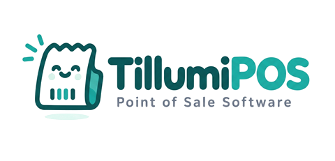
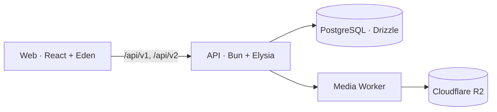

<h1 align="center">
  
</h1>

<p align="center">
  ระบบขายหน้าร้านสำหรับร้านค้าปลีกและร้านอาหาร รองรับการทำงานหลายสาขา
</p>

<p align="center">
  
  
  
  
  
</p>

TillumiPOS รวมงานขาย การจัดการสินค้าและสต็อก ออเดอร์สำหรับร้านอาหาร และการดูแลกะไว้ในระบบเดียว หน้าจอรองรับภาษาไทยและอังกฤษ ส่วน API แยกกฎธุรกิจออกจากฐานข้อมูลและเว็บไคลเอนต์

## ความสามารถ

| | |
|---|---|
| **ขายหน้าร้าน** | ค้นหาหรือสแกนสินค้า ใช้ส่วนลด รับชำระเงินสด พร้อมเพย์ หรือบัตร และพิมพ์ใบเสร็จ |
| **ออเดอร์และโต๊ะ** | เปิดออเดอร์ค้าง ผูกกับโต๊ะ ย้ายโต๊ะ รวมออเดอร์ และแยกบิลตามรายการ |
| **ตัวเลือกสินค้า** | ตั้งกลุ่มตัวเลือก เช่น ความหวานหรือท็อปปิง เพิ่มราคาและต้นทุน แล้วเลือกตอนขาย |
| **สินค้าและสต็อก** | จัดการสินค้า หมวดหมู่ รูปภาพ รับสินค้าเข้า ปรับยอด และดูประวัติการเคลื่อนไหว |
| **หลายสาขา** | แยกสต็อกและบิลตามสาขา พร้อมกำหนดสาขาที่ผู้ใช้ทำงานได้ |
| **กะและเงินสด** | จัดการเครื่องคิดเงิน เปิดกะ บันทึกเงินเข้าออก นับเงินปิดกะ และดูรายงานกะ |
| **QR ของ SCB** | สร้าง QR และตรวจสถานะการชำระกับ SCB; ต้องตั้งค่าข้อมูลร้านค้าและทดสอบการชำระจริงก่อนเปิดใช้ |
| **ตั้งค่าร้าน** | ตั้งชื่อร้าน ข้อมูลใบเสร็จ สกุลเงิน ภาษี เขตเวลา และภาษาของหน้าจอ |

## โครงสร้างระบบ



| แอป | หน้าที่และเทคโนโลยี |
|---|---|
| `apps/web` | React, Vite, Tailwind, shadcn/ui, TanStack Query และ Zustand; เรียก API ผ่าน Elysia Eden ที่ใช้ type จากฝั่งเซิร์ฟเวอร์ |
| `apps/api` | Bun, Elysia, Drizzle, PostgreSQL, tsyringe และ Zod; จัดโค้ดตาม Hexagonal Architecture และ CQRS |
| `apps/media` | Cloudflare Worker สำหรับเก็บและให้บริการรูปสินค้าผ่าน R2 |

## เริ่มใช้งานในเครื่อง

### สิ่งที่ต้องมี

- [Bun](https://bun.sh/)
- Docker พร้อม Docker Compose

### ติดตั้งและเริ่มระบบ

คัดลอกไฟล์ตัวอย่างเป็น `.env`:

```powershell
Copy-Item .env.example .env
```

หรือบน macOS/Linux:

```sh
cp .env.example .env
```

ก่อนเริ่ม ให้ตั้ง `JWT_SECRET`, `MEDIA_TOKEN` และ `SEED_OWNER_PASSWORD` ใน `.env` ให้เป็นค่าของเครื่องนี้ ค่า SCB ในไฟล์ตัวอย่างเป็น placeholder; เว้นไว้ได้หากยังไม่เปิดใช้ QR จากธนาคาร

จากโฟลเดอร์หลักของ repo:

```sh
bun install
bun run db:up
bun run db:migrate
bun run db:seed
bun run dev
```

`db:seed` สร้างผู้ใช้เจ้าของร้านชื่อ `admin` โดยใช้รหัสผ่านจาก `SEED_OWNER_PASSWORD` และเพิ่มหมวดหมู่กับสินค้าเริ่มต้น หากฐานข้อมูลมีผู้ใช้อยู่แล้ว seed จะข้ามการสร้างข้อมูล

เมื่อบริการเริ่มทำงานแล้ว:

| บริการ | ที่อยู่ในเครื่อง |
|---|---|
| เว็บ | `http://localhost:5173` |
| API | `http://localhost:3000/api/v1` |
| API docs | `http://localhost:3000/openapi` |
| Media Worker | `http://localhost:8787` |

Vite ส่งต่อคำขอ `/api` และ `/openapi` ไปยัง API ในเครื่องให้อัตโนมัติ

### โหมดกะ

ระบบเริ่มด้วย `CHECKOUT_MODE=legacy` เพื่อใช้ขั้นตอนขายเดิม หากต้องการเปิด checkout ที่ผูกกับกะ ให้ตรวจขั้นตอนและผลกระทบของการเปลี่ยนโหมดใน [คู่มือ cash shift cutover](docs/cash-shift-cutover.md) ก่อนตั้งเป็น `shifts` การเปิดใช้จริงต้องตรวจฐานข้อมูลและ QR ที่ค้างอยู่ก่อน

## ตรวจโค้ด

```sh
bun run typecheck
bun run lint
bun run test:unit
bun run test
bun run e2e
```

`bun run test` รันชุดทดสอบ API และเว็บ ส่วน integration tests และ E2E ต้องใช้ PostgreSQL ใน Docker โดย E2E จะลบแล้วสร้างฐานข้อมูลทดสอบชื่อ `pos_e2e` ใหม่ทุกครั้ง อย่าใช้ฐานข้อมูลชื่อนี้เก็บข้อมูลที่ต้องการรักษาไว้

ตรวจสัญญา OpenAPI ได้จากแพ็กเกจ API:

```sh
cd apps/api
bun run openapi:check
```

## การตั้งค่าที่เกี่ยวกับความลับ

- เก็บค่าจริงใน `.env` ที่ root ของ repo; ห้ามใส่ credentials ใน `.env.example`, โค้ด หรือไฟล์ที่ commit
- `.env.example` ใช้สำหรับแสดงชื่อตัวแปรและค่าตัวอย่างเท่านั้น
- Media Worker ในเครื่องใช้ `MEDIA_TOKEN` จาก `.env`; ตอน deploy ให้ตั้ง secret ของ Worker ด้วย `wrangler secret put MEDIA_TOKEN`
- SCB QR ใช้ค่า `SCB_API_KEY`, `SCB_API_SECRET`, `SCB_BILLER_ID` และ `SCB_REF3_PREFIX`; production ต้องกำหนด base URL ที่ SCB แจ้งให้ร้าน
- การทดสอบ SCB ใช้เซิร์ฟเวอร์จำลองใน repo อย่าตั้งชุดทดสอบให้เรียกธนาคารจริง

## เอกสารใน repo

| เอกสาร | ใช้ดูเรื่อง |
|---|---|
| [`AGENTS.md`](AGENTS.md) | ข้อตกลงการพัฒนา โครงสร้าง API และเว็บ การทำงานกับ branch และความลับ |
| [`DESIGN.md`](DESIGN.md) | แนวทางออกแบบหน้าจอและการโต้ตอบ |
| [`docs/superpowers/roadmap.md`](docs/superpowers/roadmap.md) | ลำดับความสามารถและงานที่วางแผนไว้ |
| [`docs/superpowers/specs/`](docs/superpowers/specs/) | รายละเอียดการออกแบบรายความสามารถ |
| [`docs/superpowers/plans/`](docs/superpowers/plans/) | แผนงานสำหรับการพัฒนา |
| [`docs/cash-shift-cutover.md`](docs/cash-shift-cutover.md) | ข้อควรตรวจสอบก่อนเปิดโหมดกะ |
